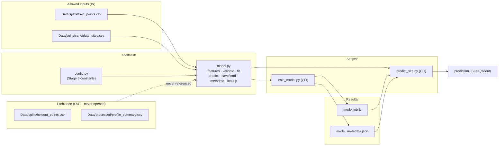

# Design Document

## Overview

Stage 3 adds a first, working temperature predictor: an `ExtraTreesRegressor`
(scikit-learn) fit on the Stage 2 training candidate profiles and reused by a
reusable prediction function, a training CLI, and a prediction CLI. The design
holds one central principle — the **data boundary**: pre-reveal code references
only `Data/splits/train_points.csv` and `Data/splits/candidate_sites.csv` (plus
the model artifacts it writes under `Results/`), and never
`Data/splits/heldout_points.csv` or `Data/processed/profile_summary.csv`.
Enforcement is by construction (no code path names the forbidden files) and by
focused tests that assert those files are never opened. Stage 3 adds no
forecasts, uncertainty, recommendations, maps, UI, or deployment, and leaves
Stage 1 and Stage 2 untouched.

## Architecture

New logic lives in `shelfcast/model.py`; new constants are appended to
`shelfcast/config.py` (Stage 1 and Stage 2 sections unchanged). Two CLIs in
`Scripts/` follow the `split_replay.py` pattern. The model artifact and
metadata JSON are written under `Results/`.



New runtime dependencies: `scikit-learn` (ExtraTreesRegressor), `joblib`
(serialization; ships with scikit-learn), and `numpy` (transitive via sklearn).

## Components and Interfaces

### `shelfcast/config.py` (additions only)

```python
# Stage 3 constants (additive; Stage 1 and Stage 2 sections unchanged)
from datetime import datetime, timezone

TIME_REFERENCE = datetime(2024, 1, 1, 0, 0, 0, tzinfo=timezone.utc)  # Req 1.2
FEATURE_ORDER = ["latitude", "longitude", "depth_m", "hours_since_reference"]  # Req 1.2
TARGET_COLUMN = "temperature_c"                 # Req 1.3
DEFAULT_DEPTH_GRID = [5.0, 10.0, 20.0, 30.0, 50.0]  # requested prediction levels in metres, NOT the actual bottom depth at a site (Req 4.2, 4.9)
RANDOM_STATE = 42                               # Req 1.4, 6.1

TRAIN_POINTS_PATH = "Data/splits/train_points.csv"      # Req 5.1
CANDIDATE_SITES_PATH = "Data/splits/candidate_sites.csv"  # Req 5.1
RESULTS_DIR = "Results"
MODEL_PATH = "Results/model.joblib"             # Req 3.2
METADATA_PATH = "Results/model_metadata.json"   # Req 3.3

CANDIDATE_PROFILE_NOTE = (
    "Groups are provisional candidate profiles inferred from recorded position "
    "and time proximity; they are NOT verified fishing tows or casts."
)
```

### `shelfcast/model.py` (new)

```python
def hours_since_reference(utc_time: datetime) -> float:
    """Hours (float) from TIME_REFERENCE to utc_time. Requires tz-aware UTC."""

def build_feature_row(lat: float, lon: float, depth_m: float,
                      utc_time: datetime) -> list[float]:
    """Return the four features in FEATURE_ORDER for one depth (Req 1.2, 2.3)."""

def validate_training_frame(df: pd.DataFrame) -> None:
    """Raise ValueError if required columns are missing, any feature/target value
    is non-numeric or non-finite (NaN/+/-inf), or any time is not a valid UTC
    timestamp. Runs fully before any fit/write (Req 1.5, 1.6, 1.7)."""

def fit_model(df: pd.DataFrame, random_state: int = RANDOM_STATE):
    """Validate then fit ExtraTreesRegressor on FEATURE_ORDER -> TARGET_COLUMN
    with fixed random_state. Returns the fitted estimator (Req 1.1-1.4)."""

def predict_temperatures(model, lat: float, lon: float, utc_time: datetime,
                         depths: list[float]) -> list[float]:
    """Reusable prediction path. Empty depths -> [] without invoking the model
    (Req 2.4). Every supplied depth must be a FINITE number > 0 metres (reject
    NaN, +/-inf, zero, negative); a non-empty list with any invalid depth raises
    ValueError and does NOT invoke the model (Req 2.5). Otherwise returns one
    finite temperature per depth, order preserved one-to-one with depths
    (Req 2.1, 2.2, 2.3, 2.6)."""

def save_model(model, path: str = MODEL_PATH) -> None:
    """Serialize with joblib (Req 3.2)."""

def load_model(path: str = MODEL_PATH):
    """Load a joblib-serialized model (Req 5.2 — not an observational input)."""

def build_metadata(n_rows: int, n_candidate_profiles: int,
                   random_state: int = RANDOM_STATE) -> dict:
    """Assemble the Metadata_Report dict (Req 3.3)."""

def lookup_candidate_site(profile_id: int,
                          path: str = CANDIDATE_SITES_PATH) -> dict:
    """Read candidate_sites.csv using ONLY columns
    [profile_id, latitude, longitude, start_time] (Req 5.3). Return
    {latitude, longitude, start_time(tz-aware UTC)} for the one matching row.
    Raise KeyError if the profile_id matches no row (Req 4.1, 4.5). Raise a clear
    error (ValueError) if the profile_id matches MORE THAN ONE row — ambiguous
    (Req 4.8)."""
```

Serialization: **joblib** is the scikit-learn standard for persisting fitted
estimators and is declared as a dependency. `save_model`/`load_model` wrap it so
no other module touches serialization.

### `Scripts/train_model.py` (CLI)

Follows the `split_replay.py` pattern: insert project root on `sys.path`,
`argparse`, call into `shelfcast.model`, catch
`(FileNotFoundError, KeyError, ValueError)`, print to stderr and return non-zero
on failure, print a success summary and return `0` otherwise.
`main(argv=None) -> int`; `if __name__ == "__main__": sys.exit(main())`.

```
python Scripts/train_model.py
    --train    Data/splits/train_points.csv   (default TRAIN_POINTS_PATH)
    --model    Results/model.joblib            (default MODEL_PATH)
    --metadata Results/model_metadata.json     (default METADATA_PATH)
```

Zero-row / missing / unreadable training points -> write nothing, message to
stderr, non-zero exit (Req 3.4). On success, writes both artifacts and prints a
summary (Req 3.2, 3.3, 3.5).

### `Scripts/predict_site.py` (CLI)

Same CLI pattern. Loads the saved model, looks up the candidate site, chooses
the depth list, and calls `predict_temperatures`.

```
python Scripts/predict_site.py
    --profile-id INT                 (required)
    --depths     FLOAT [FLOAT ...]   (optional; omitted -> DEFAULT_DEPTH_GRID)
    --model      Results/model.joblib (default MODEL_PATH)
    --sites      Data/splits/candidate_sites.csv (default CANDIDATE_SITES_PATH)
```

Validation (Req 4.6): if `--depths` is supplied but empty or contains any value
that is not a FINITE number > 0 metres (reject NaN, +/-inf, zero, negative),
print error to stderr, produce no predictions, non-zero exit. Unknown profile_id
-> error, no predictions, non-zero exit (Req 4.5); an ambiguous profile_id that
matches multiple rows -> error, no predictions, non-zero exit (Req 4.8).
Requested depths are treated as requested prediction levels only and are NOT
presented as the actual bottom depth of a candidate profile or site (Req 4.9).
On success emits the prediction JSON to stdout (Req 4.7):

```json
{
  "profile_id": 12,
  "utc_time": "2024-09-01T13:00:00+00:00",
  "predictions": [
    {"depth_m": 5.0, "temperature_c": 14.2},
    {"depth_m": 10.0, "temperature_c": 13.1}
  ]
}
```

The `predictions` list order matches the selected depth list one-to-one
(Req 4.4).

## Data Models

### Metadata_Report — `Results/model_metadata.json` (Req 3.3)

```json
{
  "feature_order": ["latitude", "longitude", "depth_m", "hours_since_reference"],
  "time_reference": "2024-01-01T00:00:00+00:00",
  "random_state": 42,
  "n_rows": 1234,
  "n_candidate_profiles": 57,
  "candidate_profile_note": "Groups are provisional candidate profiles inferred from recorded position and time proximity; they are NOT verified fishing tows or casts."
}
```

`random_state` is the recorded deterministic seed. `n_candidate_profiles` is the
count of distinct `profile_id` values in the training points.

### Prediction output JSON (Req 4.7)

```json
{
  "profile_id": 12,
  "utc_time": "2024-09-01T13:00:00+00:00",
  "predictions": [{"depth_m": 5.0, "temperature_c": 14.2}]
}
```

### Feature row (in-memory, Req 1.2 / 2.3)

Ordered `[latitude, longitude, depth_m, hours_since_reference]` where
`hours_since_reference = (utc_time - TIME_REFERENCE).total_seconds() / 3600`.

## Data Boundary Enforcement

Enforcement is **by construction plus tests** — no runtime interceptor.

- By construction: Stage 3 code references only `TRAIN_POINTS_PATH`,
  `CANDIDATE_SITES_PATH`, and the `Results/` artifact paths. No function names,
  imports, or opens `heldout_points.csv` or `profile_summary.csv`.
  `lookup_candidate_site` reads only the four allowed columns (Req 5.3).
- By tests: a focused test wraps `pandas.read_csv` (and `builtins.open`) with a
  `monkeypatch` spy that records every opened path, runs the training path and
  the prediction path, and asserts the recorded set contains neither
  `heldout_points.csv` nor `profile_summary.csv` (Req 5.4, 5.5, 5.6). The
  end-to-end smoke test applies the same spy across train -> predict (Req 9.3).

## Correctness Properties

*A property is a characteristic or behavior that should hold true across all
valid executions of a system — a formal statement about what the system should
do, serving as the bridge between human-readable specifications and
machine-verifiable correctness guarantees.*

### Property 1: Data boundary — forbidden files never opened

*For any* training run and *for any* prediction run, the set of file paths
opened during that run contains neither `heldout_points.csv` nor
`profile_summary.csv`. (Checked by the no-open spy test.)

**Validates: Requirements 5.4, 5.5, 5.6**

### Property 2: One finite temperature per depth, order preserved

*For any* fitted model, latitude, longitude, UTC time, and non-empty list of
depths (all finite and `> 0`), `predict_temperatures` returns a list of the same
length as the depths, in the same order, every element a finite number (no NaN,
no +/-inf).

**Validates: Requirements 2.1, 2.2, 2.6**

### Property 3: Empty or invalid depths do not invoke the model

*For any* fitted model and inputs, calling `predict_temperatures` with an empty
depth list returns `[]` and does not invoke the model; and *for any* non-empty
depth list containing a value that is not a finite number `> 0` metres, the call
raises an error and does not invoke the model.

**Validates: Requirements 2.4, 2.5**

### Property 4: Exactly four features in declared order

*For any* latitude, longitude, depth, and UTC time, `build_feature_row` returns
exactly four values ordered as `FEATURE_ORDER`, with the fourth equal to hours
since `TIME_REFERENCE`.

**Validates: Requirements 1.2, 2.3**

### Property 5: Explicit depths override the default grid

*For any* non-empty list of valid depths (all `> 0`), the prediction CLI uses
exactly those depths; when no depths are supplied it uses `DEFAULT_DEPTH_GRID`.
(Default/override selection checked by example tests; per-depth correspondence
by Property 2.)

**Validates: Requirements 4.2, 4.3, 4.4**

### Property 6: Reproducibility — identical inputs produce identical outputs

*For any* training frame, two fits with the fixed `random_state` produce models
that return identical predictions for identical query inputs; and *for any*
single model, two calls to `predict_temperatures` with identical inputs return
identical temperatures.

**Validates: Requirements 1.4, 6.1, 6.2**

### Property 7: Invalid input rejected, no artifact written

*For any* training frame containing a missing required column, a non-numeric or
non-finite feature/target value, or an invalid UTC timestamp, the fit stops with
an error naming the failure and writes no model artifact.

**Validates: Requirements 1.5, 1.6, 1.7**

## Error Handling

Errors are raised as standard exceptions from `shelfcast/model.py` and caught at
the CLI boundary, matching the `split_replay.py` pattern (catch
`(FileNotFoundError, KeyError, ValueError)`, print to stderr, return non-zero).

| Failure | Raised by | Mapped to | Requirement |
| --- | --- | --- | --- |
| Training points missing / unreadable | `fit_model` / loader (`FileNotFoundError`) | stderr message, no artifact, non-zero exit | 1.5, 3.4 |
| Zero training rows | `fit_model` (`ValueError`) | stderr message, no artifact, non-zero exit | 3.4 |
| Missing required column, non-numeric value | `validate_training_frame` (`ValueError`) | naming error, no artifact | 1.5 |
| Non-finite value (NaN/+/-inf) or invalid UTC timestamp | `validate_training_frame` (`ValueError`) | naming error, no artifact | 1.6, 1.7 |
| Unknown profile_id | `lookup_candidate_site` (`KeyError`) | "profile_id not found" message, no predictions, non-zero exit | 4.5 |
| profile_id matches multiple rows (ambiguous) | `lookup_candidate_site` (`ValueError`) | ambiguous-profile_id message, no predictions, non-zero exit | 4.8 |
| Empty, non-finite, or non-positive depths (CLI) | `predict_site.py` (`ValueError`) | invalid-depths message, no predictions, non-zero exit | 4.6 |

Validation runs fully before any fit or write, so a rejected training frame
leaves `Results/` untouched (ordering guarantee, not a transaction — mirrors the
Stage 2 "validate before write" approach). The empty-depths case is handled as a
normal return (`[]`), not an error (Req 2.4).

## Testing Strategy

Focused `pytest` tests in `tests/test_model.py`, following the
`test_split.py` pattern (real `Data/splits/` files where present; small
synthetic DataFrames for error paths). Every property in the Correctness
Properties section is verified by focused, example-based `pytest` tests plus the
single end-to-end smoke check — not by a property-based testing framework.

| Area | Type | Tests |
| --- | --- | --- |
| Validation (Req 1.5-1.7) | Example | Missing column, NaN, +/-inf, bad timestamp each rejected with a naming error; assert no artifact written |
| Prediction contract (Req 2.1-2.3, 2.6, Property 2, 4) | Example | Representative lat/lon/time/depths -> same length, order preserved, all finite; four features in order |
| Invalid depths to function (Req 2.5, Property 3) | Example | Non-empty list with NaN/+/-inf/zero/negative -> `ValueError`, model not invoked (spy) |
| Empty depths (Req 2.4, Property 3) | Example | Empty list -> `[]`, model not invoked (spy) |
| Depth selection (Req 4.2-4.4, 4.9, Property 5) | Example | Omitted -> default grid; supplied valid -> override; invalid/empty -> error, no predictions |
| Reproducibility (Req 1.4, 6.1-6.2, Property 6) | Example | Two fits -> identical predictions; two predict calls -> identical outputs |
| Data boundary (Req 5.4-5.6, Property 1) | Example | monkeypatch spy on `read_csv`/`open`; forbidden paths absent on train and predict paths |
| Candidate lookup (Req 4.1, 4.5, 4.8, 5.3) | Example | Known id -> row; unknown id -> `KeyError`; duplicate id -> `ValueError`; only four columns read |
| Prediction JSON shape (Req 4.7) | Example | Output has `profile_id`, `utc_time`, ordered depth/temperature pairs |
| CLI failure (Req 3.4, 4.5, 4.6, 4.8) | Example | subprocess runs with bad inputs -> non-zero exit, stderr message, no artifact |
| End-to-end smoke (Req 9.1-9.3) | Example | Train on real train_points -> predict one candidate site at fixed depths -> assert finite + heldout not opened |

Stage 3 uses focused example tests and one end-to-end smoke check only. Each
example test targets a concrete case for its property (contract, reproducibility,
boundary, validation); the sklearn estimator itself is not re-tested (it is the
library's responsibility). Tests target ShelfCast's feature, validation,
prediction, and boundary logic.

## Scope / Non-Goals

- No forecasts, uncertainty/confidence values, or measurement-location
  recommendations (Req 7.1).
- No map, spatial visualization, dashboard, UI, deployment, or hosting
  (Req 7.2).
- Stage 1 and Stage 2 code, files, and outputs are left unchanged; `config.py`
  additions are purely additive (Req 7.3).
- Operate within the existing Stage 1 study region; do not expand it (Req 7.4).
- Groups are described only as "candidate profiles", never verified fishing
  tows or casts, in every output and document (Req 7.5).
- `README.md` and `.kiro/steering/shelfcast-purpose-scope.md` are updated to
  state "Stage 1 and 2 complete; Stage 3 active" with the Stage 3 scope
  (Req 8.1, 8.2).

## Requirements Traceability

| Design section | Requirements |
| --- | --- |
| Overview | Introduction, 7 |
| Architecture | 1, 2, 3, 4, 5 |
| Components — config additions | 1.2-1.4, 3.2-3.3, 4.2, 5.1, 6.1 |
| Components — `model.py` | 1.1-1.7, 2.1-2.6, 3.2-3.3, 4.1, 4.5, 4.8, 5.2-5.3 |
| Components — `train_model.py` | 3.1-3.5 |
| Components — `predict_site.py` | 4.1-4.9 |
| Data Models | 1.2, 2.3, 3.3, 4.7 |
| Data Boundary Enforcement | 5.1-5.6, 9.3 |
| Correctness Properties | 1.2, 1.4-1.7, 2.1-2.6, 4.2-4.4, 5.4-5.6, 6.1-6.2 |
| Testing Strategy | 1.4-1.7, 2.1-2.6, 3.4, 4.1-4.9, 5.3-5.6, 6.1-6.2, 9.1-9.3 |
| Scope / Non-Goals | 7.1-7.5, 8.1-8.2 |
