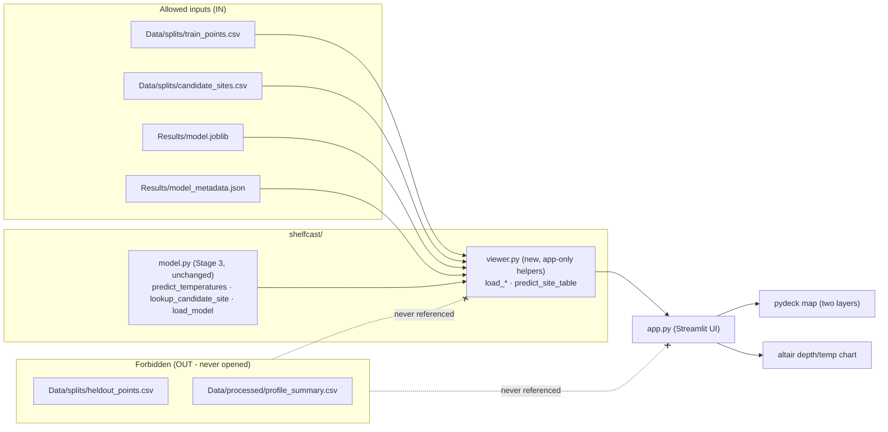

# Design Document

## Overview

Stage 4 is a single local Streamlit app, `app.py`, at the project root, launched
with `streamlit run app.py`. It is a thin, read-only viewer over the existing
Stage 3 artifacts: it loads `Results/model.joblib` and
`Results/model_metadata.json`, reads `Data/splits/train_points.csv` and
`Data/splits/candidate_sites.csv`, draws the two location layers on a map, lets
the user pick a candidate profile, and charts the Stage 3 predicted temperatures
at the declared standard depths (`DEFAULT_DEPTH_GRID`) for the site's recorded
location and UTC start time.

The app reuses `shelfcast.model.predict_temperatures` and
`shelfcast.model.lookup_candidate_site` unchanged, so the charted values are
identical to the Stage 3 CLI's. A small amount of app-only logic (loading,
assembling the prediction table) lives in `shelfcast/viewer.py` so it is
importable and testable without launching Streamlit; `app.py` itself holds only
layout and widget wiring.

The central Stage 3 **data boundary** carries forward unchanged: no Stage 4 code
names, imports, or opens `heldout_points.csv` or `profile_summary.csv`, and the
app never displays a hidden temperature or depth. Enforcement is by construction
plus a focused no-open test. Stage 4 adds no retraining, uncertainty,
recommendations, forecasts, or deployment.

## Architecture



Libraries are already installed: **Streamlit** (UI + `st.pydeck_chart`),
**pydeck** (map layers), **altair** (depth/temperature chart), plus the existing
pandas / scikit-learn / joblib. No new runtime dependency is strictly required;
`requirements.txt` gains pinned entries for the app-facing libraries
(`streamlit`, `pydeck`, `altair`) so a fresh environment can run the app.

## Components and Interfaces

### `shelfcast/viewer.py` (new — app-only, importable, testable)

```python
TRAIN_POINTS_PATH, CANDIDATE_SITES_PATH, MODEL_PATH, METADATA_PATH  # from config

def load_metadata(path: str = METADATA_PATH) -> dict:
    """Read the Stage 3 Model_Metadata JSON. Raise FileNotFoundError if absent."""

def load_fitted_model(path: str = MODEL_PATH):
    """Load the Saved_Model via shelfcast.model.load_model. Raise
    FileNotFoundError if the artifact is absent (so app.py can show guidance)."""

def load_training_locations(path: str = TRAIN_POINTS_PATH) -> pd.DataFrame:
    """Read ONLY [latitude, longitude] from Training_Points for the map layer.
    No temperature or depth column is read."""

def load_candidate_sites(path: str = CANDIDATE_SITES_PATH) -> pd.DataFrame:
    """Read ONLY [profile_id, latitude, longitude, start_time] from
    Candidate_Sites (the four allowed columns, matching Stage 3)."""

def predict_site_table(model, site: dict, depths: list[float]) -> pd.DataFrame:
    """Reuse shelfcast.model.predict_temperatures for one site. `site` is the
    dict returned by lookup_candidate_site ({latitude, longitude, start_time}).
    Return a DataFrame with columns depth_m and temperature_c, one row per depth,
    in depth order. Does not open any file."""
```

`load_training_locations` uses `pandas.read_csv(..., usecols=["latitude",
"longitude"])` so no hidden column is ever materialized. `load_candidate_sites`
uses the same four-column `usecols` as Stage 3's `lookup_candidate_site`.
Prediction reuses the Stage 3 path verbatim, guaranteeing value parity with the
CLI.

### `app.py` (new — Streamlit UI at project root)

Launched with `streamlit run app.py`. Responsibilities, top to bottom:

1. Page config: ocean theme, title "ShelfCast — candidate-profile temperature
   viewer", wide layout.
2. Load artifacts via `viewer.py`. If the model/metadata is missing, show a
   clear `st.error` telling the user to run `python Scripts/train_model.py`, then
   `st.stop()` — no prediction attempted (Req 1.3).
3. Map section: a `pydeck` deck with two `ScatterplotLayer`s — training
   locations (muted) and candidate sites (highlighted) — rendered via
   `st.pydeck_chart`. A legend states which layer is which and that candidate
   markers are candidate profiles (Req 2).
4. Selection: a `st.selectbox` of candidate `profile_id`s. On selection, call
   `lookup_candidate_site`, show recorded lat/lon and UTC start time (Req 3).
5. Prediction chart: call `predict_site_table` with `DEFAULT_DEPTH_GRID`, draw an
   altair chart of temperature (°C, x) vs depth (m, y, inverted so deeper is
   lower), units in axis titles, plus a companion table (Req 4).
6. Context panel: dataset attribution, "historical replay" note, provisional
   candidate-profile limitation, and unknown-bottom-depth limitation (Req 5).

All profile wording is "candidate profile". The app displays only recorded
coordinates/time and model-predicted temperatures — never a hidden observed
value.

### Ocean-themed layout

A restrained ocean palette via a small `.streamlit/config.toml` theme (deep-navy
primary, light sea-foam background accents) and minimal inline markdown. No heavy
CSS; the theme file keeps styling declarative and the layout clean.

## Data Models

### Prediction table (in-memory, Req 4)

| column | unit | source |
| --- | --- | --- |
| `depth_m` | metres | `DEFAULT_DEPTH_GRID` (requested prediction levels) |
| `temperature_c` | degrees Celsius | `predict_temperatures` output |

One row per standard depth, in depth order, one-to-one with the grid.

### Map layers (Req 2)

- Training layer: rows of `{latitude, longitude}` from Training_Points (no other
  column read).
- Candidate layer: rows of `{profile_id, latitude, longitude}` from
  Candidate_Sites.

## Data Boundary Enforcement

Same approach as Stage 3 — **by construction plus tests**:

- By construction: Stage 4 code references only `TRAIN_POINTS_PATH`,
  `CANDIDATE_SITES_PATH`, `MODEL_PATH`, and `METADATA_PATH`. `read_csv` calls use
  `usecols` whitelists, so even the allowed files never surface a hidden column.
  No function names, imports, or opens `heldout_points.csv` or
  `profile_summary.csv`.
- By tests: `tests/test_viewer.py` wraps `pandas.read_csv` and `builtins.open`
  with a spy, runs `load_training_locations`, `load_candidate_sites`,
  `load_fitted_model`, `load_metadata`, and one `predict_site_table`, and asserts
  the recorded path set contains neither `heldout_points.csv` nor
  `profile_summary.csv` (Req 6.4).

## Correctness Properties

### Property 1: Data boundary — forbidden files never opened

*For any* app data-load plus one site prediction, the set of opened file paths
contains neither `heldout_points.csv` nor `profile_summary.csv`.

**Validates: Requirements 6.1, 6.2, 6.4**

### Property 2: CLI parity — the chart matches the Stage 3 CLI

*For any* candidate `profile_id` and the standard depths, the temperatures in
`predict_site_table` equal the temperatures the Stage 3 prediction CLI emits for
the same profile and depths (same reused prediction path).

**Validates: Requirements 4.1, 4.2, 7.2**

### Property 3: One temperature per standard depth, order preserved

*For any* selected site, `predict_site_table` returns one row per standard depth,
in depth order, every temperature finite.

**Validates: Requirement 4.2**

## Error Handling

| Failure | Handling | Requirement |
| --- | --- | --- |
| Missing `Results/model.joblib` or metadata | `load_*` raises `FileNotFoundError`; `app.py` shows guidance and `st.stop()` | 1.3 |
| Missing/unreadable Training_Points or Candidate_Sites | `read_csv` raises; `app.py` shows a clear error | 1.2 |
| Candidate lookup returns no/ambiguous row | Reuses Stage 3 `lookup_candidate_site` (`KeyError`/`ValueError`); app shows the message | 3.1 |

The app never writes to `Results/` or any data file; it is strictly read-only.

## Testing Strategy

Focused `pytest` tests in `tests/test_viewer.py`, following the existing
`test_model.py` style (real `Data/splits/` and `Results/` files where present;
spies for the boundary):

| Area | Type | Test |
| --- | --- | --- |
| Data boundary (Req 6, Property 1) | Example | Spy on `read_csv`/`open` across all loaders + one prediction; forbidden paths absent |
| CLI parity (Req 4.1-4.2, Property 2) | Example | `predict_site_table` for a real profile equals `predict_temperatures` called directly with the CLI's inputs |
| Depth contract (Req 4.2, Property 3) | Example | One row per `DEFAULT_DEPTH_GRID` depth, in order, all finite |
| usecols whitelist (Req 6.2, 6.3) | Example | `load_training_locations` reads only lat/lon; `load_candidate_sites` reads only the four allowed columns |

No Streamlit UI automation; `app.py` stays thin and declarative, and all logic
worth testing lives in `viewer.py`. Existing Stage 1-3 tests must continue to
pass unchanged.

## Scope / Non-Goals

- No model retraining, refitting, uncertainty/confidence, next-site
  recommendations, forecasts, deployment, or hosting (Req 7.1).
- Reuse the Stage 3 `predict_temperatures` unchanged; leave Stage 1-3 code,
  files, and outputs unchanged (Req 7.2).
- Operate within the existing Stage 1 study region; do not expand it (Req 7.3).
- Groups are described only as "candidate profiles", never verified fishing tows
  or casts (Req 7.4).
- Use already-installed libraries (Streamlit, pydeck, altair); add only the
  dependencies needed for the app (Req 7.5).
- Update `README.md` and `.kiro/steering/shelfcast-purpose-scope.md` to "Stages
  1-3 complete; Stage 4 active", preserving historical stage descriptions
  (Req 8.1, 8.2).
