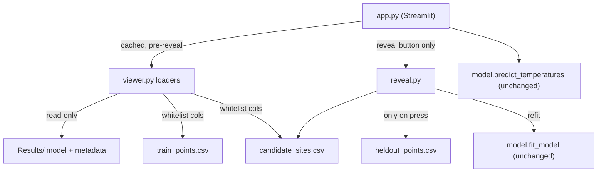

# Design Document

## Overview

Stage 5 adds a controlled "reveal loop" on top of the Stage 4 viewer. The user
selects a candidate profile, sees the Stage 3 predicted curve (unchanged), and
may press one button to reveal that single profile's hidden historical
measurements. On reveal the app overlays the real readings at their true
recorded depths, fits an in-memory temporary model from the original training
rows plus only that profile's revealed rows, and shows original-vs-temporary
predicted curves for the selected site and one nearby still-hidden site (plus a
map-marker update and a numeric prediction change for that nearby site).

The central constraint is the **data boundary**: `Data/splits/heldout_points.csv`
is opened by exactly one new function, `reveal.read_revealed_profile`, and only
inside the button-press branch, after the "Reveal actual measurements" click.
Only the selected profile's rows may be returned, stored in session state, used
for fitting, or shown -- no other profile's rows are ever returned or used. The
existing `viewer.py` cached loaders and all pre-reveal paths stay free of any
heldout access so the boundary is structurally obvious rather than merely
conventional. Stages 1-3 are reused unchanged (`fit_model`,
`predict_temperatures`, `lookup_candidate_site`); the temporary model is never
written to disk.

This is a historical replay, not a live or future forecast. The chronological
replay split means training candidate profiles ended (`end_time`) strictly
before the cutoff of 2024-08-06T00:00:00Z UTC, while the selected hidden profile
started (`start_time`) on or after that cutoff. The app adds no uncertainty
bands, confidence claims, next-site recommendations, or deployment.

## Architecture

New module `shelfcast/reveal.py` holds all reveal-only logic. `heldout_points.csv`
is opened only by `read_revealed_profile`, only after the "Reveal actual
measurements" click, and only the selected profile's rows are returned, used,
stored, or shown -- no other profile's rows (Req 3.1, 3.2, 3.5).
`read_revealed_profile` filters to the selected `profile_id` before returning.
`app.py` imports `reveal` and calls `read_revealed_profile` only inside the
reveal button handler. `viewer.py` and its cached loaders are untouched, keeping startup, map,
selection, and pre-reveal prediction on the Stage 3/4 whitelists
(`train_points.csv`, `candidate_sites.csv`, `Results/`) only, never opening
`heldout_points.csv` (Req 3.3, 3.6).



Data flow on a reveal press: `read_revealed_profile(selected_id)` → revealed
rows; `load_training_rows()` → training frame; `fit_temporary_model(train,
revealed)` → in-memory model; `after_time = revealed_final_time(revealed_df)`
then `nearest_candidate_site(selected_id, sites_df, after_time)` → comparison
site (or `None`). `app.py` then predicts original and temporary curves for both
sites via the unchanged `predict_temperatures` and renders the overlay charts;
when the comparison site is `None` it shows the "no eligible nearby site"
message instead of the nearby-site output.
For the nearby site it also calls `nearby_site_delta(...)` to update that site's
map marker (original-then-temporary predicted temperature at the 20 m requested
prediction level, shown as a visible color/label change) and to display the
numeric prediction change at 20 m (temporary minus original). All nearby-site
output uses predictions only; the nearby site's heldout values are never read
(Req 6.3, 6.4, 6.5).

## Components and Interfaces

### `shelfcast/config.py` (additive)

One new constant, matching the existing path-constant style:

```python
# Stage 5 reveal input -- opened ONLY by shelfcast.reveal.read_revealed_profile.
HELDOUT_POINTS_PATH = "Data/splits/heldout_points.csv"
```

The nearby-site minimum distance is a module-level constant in `reveal.py`:

```python
MIN_NEARBY_KM = 1.0  # a nearby candidate must be at least this far (km)
```

### `shelfcast/reveal.py` (new)

The only module that opens `heldout_points.csv`. Pure, importable, testable
without Streamlit. Reuses `model.fit_model` verbatim.

```python
def read_revealed_profile(
    profile_id: int, path: str = HELDOUT_POINTS_PATH
) -> pd.DataFrame:
    """Rows of heldout_points.csv for one profile_id.

    Opened ONLY after the "Reveal actual measurements" click. Filters to the
    selected profile_id and returns ONLY those rows (columns [time, latitude,
    longitude, depth_m, temperature_c, profile_id]); no other profile's rows are
    returned, stored, used for fitting, or shown (Req 3.1, 3.2). Raises KeyError
    naming the missing id if no row matches (Req 3.4). Raises FileNotFoundError
    if heldout_points.csv does not exist (Req 3.8). The ONLY code path permitted
    to open heldout_points.csv (Req 3.5)."""

def load_training_rows(path: str = TRAIN_POINTS_PATH) -> pd.DataFrame:
    """Full source columns (time, latitude, longitude, depth_m, temperature_c)
    for refit. Reads only train_points.csv (Req 5.1)."""

def fit_temporary_model(train_df: pd.DataFrame, revealed_df: pd.DataFrame):
    """Concatenate train rows + the one profile's revealed rows and call
    model.fit_model on the combined frame. Returns an in-memory estimator.
    NEVER saves (Req 5.1, 5.3)."""

def haversine_km(lat1: float, lon1: float, lat2: float, lon2: float) -> float:
    """Great-circle distance in kilometres between two lat/lon points."""

def revealed_final_time(revealed_df: pd.DataFrame) -> pd.Timestamp:
    """The revealed profile's final recorded measurement time: the maximum
    `time` among the revealed rows."""

def nearest_candidate_site(
    selected_id: int, sites_df: pd.DataFrame, after_time: pd.Timestamp
) -> int | None:
    """profile_id of the nearest ELIGIBLE candidate (other than selected) to the
    selected site. A candidate is eligible only if it is at least MIN_NEARBY_KM
    (1.0 km) from the selected site -- great-circle distance in kilometres via
    haversine_km -- AND its recorded start_time is strictly after `after_time`
    (the revealed profile's final measurement time, from revealed_final_time).
    Among eligible candidates the nearest by kilometre distance wins, breaking
    ties by lowest profile_id. Returns None when no candidate is eligible (Req
    6.1, 6.6). Reads only candidate_sites columns -- never heldout (Req 6.5)."""

def nearby_site_delta(
    original_model, temp_model, site: dict, depth: float = 20.0
) -> dict:
    """Original and temporary predicted temperature at one requested prediction
    level (default 20 m) for a nearby still-hidden site, plus their difference.

    Returns {"original": float, "updated": float, "delta": float} where
    delta = updated - original. Uses model.predict_temperatures verbatim on the
    site's recorded coordinates and start_time -- predictions ONLY, never any
    heldout temperature_c/depth_m for the nearby site (Req 6.5). Pure and
    Streamlit-free so the map-marker recolor and numeric delta are unit-testable
    (Req 6.3, 6.4)."""
```

`read_revealed_profile` returns the full revealed columns (including `depth_m`
and `temperature_c`) because those are the values the reveal exists to show;
this is the only sanctioned exposure of hidden data and happens only after the
press.

### `app.py` (extend Stage 4)

Keep the existing cached loaders (`@st.cache_resource` for the model,
`@st.cache_data` for metadata/training-locations/candidate-sites). Add, after
`_render_prediction`:

- A `st.button("Reveal actual measurements")` control (Req 2.1).
- A `st.button("Reset replay")` control (Req 7.2). On press it clears the
  session-state keys `revealed_profile_id`, `revealed_df`, and `temp_model`,
  returning to the original saved model and the pre-reveal display (Req 7.3).
  Both this reset route and the top-of-rerun selection guard (see Data Models)
  clear the **same three keys**, so a reset and a selection change are a single
  code path with one effect.
- A reveal state guard run at the top of each rerun (see Data Models).
- A reveal handler (button branch only) that calls `reveal.*`, stores results in
  session state, and renders the overlay charts. It computes
  `after_time = reveal.revealed_final_time(revealed_df)` and calls
  `reveal.nearest_candidate_site(profile_id, sites_df, after_time)`; when that
  returns `None` it shows the "no eligible nearby site" message and skips the
  nearby-site comparison, map update, and numeric delta (Req 6.6). It also
  catches `FileNotFoundError` from `read_revealed_profile`, showing a message
  that directs the user to run `Scripts/split_replay.py` while preserving the
  pre-reveal predictions and never writing the saved model (Req 3.8).
- `_render_reveal_charts(...)` building the layered Altair charts (see Chart
  design).
- For the nearby still-hidden site: a map-marker update that recolors the nearby
  marker and sets a tooltip/label showing the original-model then
  temporary-model predicted temperature at 20 m, plus an `st.metric` showing the
  numeric prediction change at 20 m (temporary minus original, from
  `reveal.nearby_site_delta`). Both use predictions only (Req 6.3, 6.4, 6.5).

Imports add `from shelfcast import reveal` and `from shelfcast.config import
CUTOFF, LAT_MIN, LAT_MAX, LON_MIN, LON_MAX`. All displayed depths stay labeled
"requested prediction levels", and the eMOLT source attribution shows alongside
all Stage 5 output (Req 8.2, 8.4). The historical-replay caption states that the
selected hidden profile started (`start_time`) on or after the
2024-08-06T00:00:00Z UTC cutoff while the original saved model was trained only
on candidate profiles that ended (`end_time`) strictly before it -- not
"records before the cutoff" (Req 8.1). The words "tow"/"cast" appear only inside
the truthful limitation note (starter eMOLT data omits `tow_id`/`segment_type`,
so groups are provisional candidate profiles, not verified tows or casts); a
candidate profile is never labeled as a verified tow or cast (Req 8.3).

## Data Models

### Revealed rows frame
`pd.DataFrame` with columns `[time, latitude, longitude, depth_m,
temperature_c, profile_id]`, all rows sharing the selected `profile_id`.

### Combined training frame
`train_df` concatenated with `revealed_df` restricted to the five source columns
`fit_model` requires: `latitude, longitude, depth_m, time, temperature_c`. Row
order is irrelevant to `ExtraTreesRegressor`.

### Streamlit session state
Three keys, all keyed to the currently selected `profile_id`:

| key | type | meaning |
| --- | --- | --- |
| `revealed_profile_id` | `int \| None` | the id a reveal is currently held for |
| `revealed_df` | `pd.DataFrame \| None` | revealed rows for that id |
| `temp_model` | estimator `\| None` | in-memory temporary model for that id |

**Invariant:** these three are populated together, only inside the reveal button
branch, and only for the profile the user is viewing.

**Guard (runs at the top of every rerun, before any reveal rendering):**

```
if st.session_state.get("revealed_profile_id") != selected_profile_id:
    revealed_profile_id = None; revealed_df = None; temp_model = None
```

Changing the selectbox or a replay reset therefore discards the reveal and the
app falls back to the original saved model (Req 2.4, 7.1, 7.2, 7.4). Because the
guard keys on the live selectbox value and the reveal only ever writes state for
the selected id, no other profile can leak across reruns (Req 7.3, 7.5).
Revealed data is never cached: `@st.cache_data`/`@st.cache_resource` wrap only
the original model, metadata, training locations, and candidate sites.

## Correctness Properties

*A property is a characteristic that should hold true across all valid
executions of the system -- a formal statement about what the system should do,
bridging human-readable specification and machine-verifiable guarantees.*

### Property 1: Filtered reveal returns only the requested profile

*For any* `profile_id` present in a heldout table, every row returned by
`read_revealed_profile(profile_id)` has `profile_id` equal to the requested id,
and no row with a different id is returned.
**Validates: Requirements 3.1**

### Property 2: Missing id raises a naming error and reveals nothing

*For any* `profile_id` absent from the heldout table, `read_revealed_profile`
raises `KeyError` whose message contains that id and returns no rows.
**Validates: Requirements 3.3**

### Property 3: Nearest site respects eligibility or returns None

*For any* candidate-site table, selected id, and `after_time`,
`nearest_candidate_site(selected_id, sites_df, after_time)` returns an id that is
not the selected id, is at least `MIN_NEARBY_KM` kilometres away (great-circle
via `haversine_km`), and has `start_time` strictly after `after_time`; among
eligible candidates it is the nearest by kilometre distance, breaking ties by
lowest `profile_id`. When no candidate is eligible it returns `None`.
**Validates: Requirements 6.1, 6.6**

### Property 4: Temporary fit writes nothing and preserves the saved model

*For any* training frame and revealed frame, `fit_temporary_model` creates no
file and leaves the bytes of `Results/model.joblib` unchanged.
**Validates: Requirements 5.1, 5.3, 5.4**

### Property 5: Actual points keep their true depths

*For any* revealed frame, the `depth_m` values prepared for the actual-measurement
overlay equal the revealed `depth_m` values exactly -- never rounded, re-binned,
or snapped to the standard requested depths.
**Validates: Requirements 4.1, 4.3**

### Property 6: Pre-reveal and reset states never materialize heldout data

*For any* sequence of startup, map render, site selection, and reset actions
with no reveal press, no code path opens `heldout_points.csv` or reads the hidden
summary columns of `profile_summary.csv`.
**Validates: Requirements 3.3, 3.5, 3.6, 2.3**

### Property 7: Nearby-site delta is the prediction difference at 20 m

*For any* original model, temporary model, and nearby site,
`nearby_site_delta(original, temp, site, depth=20.0)` returns `original` and
`updated` equal to each model's predicted temperature at 20 m for the site's
recorded coordinates and start time, with `delta == updated - original`, reading
no heldout value for the nearby site.
**Validates: Requirements 6.4, 6.5**

### Property 8: Selection change or reset discards revealed state

*For any* revealed state held for one profile, changing the selected profile or
pressing "Reset replay" clears `revealed_profile_id`, `revealed_df`, and
`temp_model` and returns the app to the original saved model before any revealed
value is displayed.
**Validates: Requirements 7.1, 7.3, 7.5**

## Error Handling

| Condition | Handling | Requirement |
| --- | --- | --- |
| Original model fails to load | `app.py` shows "model unavailable" and stops before any value is shown (existing Stage 4 guard) | 1.4 |
| Selected `profile_id` absent from heldout | `read_revealed_profile` raises `KeyError` naming the id; handler catches it, shows a reveal error, keeps pre-reveal predictions | 2.5, 3.3 |
| Zero revealed rows for the profile | Handler shows "no actual measurements for this profile" and overlays nothing | 4.4 |
| Temporary fit fails (`fit_model` raises `ValueError`) | Handler shows "temporary model could not be fit"; original saved model untouched and unwritten | 5.4 |
| No eligible nearby candidate (none ≥ 1 km with `start_time` after the revealed final time) | `nearest_candidate_site` returns `None`; handler shows "no eligible nearby site", skips the comparison chart, map update, and numeric delta | 6.6 |
| `heldout_points.csv` missing when a reveal is requested | `read_revealed_profile` raises `FileNotFoundError`; handler catches it, shows a message directing the user to run `Scripts/split_replay.py`, keeps pre-reveal predictions, and does not write the saved model | 3.8 |
| Reset / selection change | "Reset replay" press or a changed selectbox clears the three reveal keys via the shared guard; app returns to the original saved model and pre-reveal display | 7.1, 7.3 |

All reveal errors preserve existing pre-reveal predictions and never mutate or
write the original model.

## Testing Strategy

Property-based testing applies to Stage 5's pure logic (filtering, nearest-site
selection, depth preservation, the nearby-site prediction delta, the reset guard,
and the file-boundary invariant), so a Correctness Properties section is included
above. UI composition (pydeck/Altair rendering, map-marker recolor) is covered by
focused example tests, not PBT.

**Priority:** Until the MVP runs, the five ESSENTIAL tests below are REQUIRED;
broader Hypothesis property testing is OPTIONAL and can follow once the MVP
works. The Correctness Properties section above is retained, and each property
is annotated as covered by a required or an optional test.

**Library:** Hypothesis (standard Python PBT), consistent with the existing
pytest suite. Each property test runs a minimum of 100 iterations and is tagged
with a comment of the form
`# Feature: shelfcast-stage5-reveal-loop, Property N: <text>`.

New focused tests live in `tests/test_reveal.py`, following `test_viewer.py`
conventions (the `open_spy` fixture that records every `pd.read_csv`/`open`
path, and `_require_model()` to skip when `Results/model.joblib` is absent).

REQUIRED (non-optional) essential tests -- these must pass for the MVP. They may
be written as example-based tests first:

- **Reveal-gate** (Property 6): with the `open_spy`, exercise
  `viewer.py`/pre-reveal paths (startup, map, selection, reset) and assert
  `heldout_points.csv` and `profile_summary.csv` are never opened; then assert
  it IS opened only after a reveal press, and that `read_revealed_profile` is
  the only function that opens the heldout file.
- **Profile-filter** (Property 1): `read_revealed_profile` returns only rows
  whose `profile_id` equals the selected id, and no other id's rows.
- **Model-preservation** (Property 4): spy on `joblib.dump`/`open` and assert
  `fit_temporary_model` writes nothing and the bytes of `Results/model.joblib`
  are unchanged.
- **Depth preservation** (Property 5): overlay depths equal revealed `depth_m`
  exactly -- never rounded, re-binned, or snapped.
- **Reset** (Property 8): a selection change or "Reset replay" press clears
  `revealed_profile_id`/`revealed_df`/`temp_model` and returns to the original
  saved model, verified via a small pure guard helper so `app.py` need not be
  launched.

OPTIONAL (after the MVP runs) broader property tests:

- **Missing-id error** (Property 2): generative check that absent ids raise
  `KeyError` naming the id.
- **Nearest-site selection and tie-break** (Property 3): synthesized site tables
  exercising the km and `start_time` eligibility rules, ties by lowest
  `profile_id`, and the `None` (no eligible site) case.
- **Nearby-site delta** (Property 7): generated model pairs confirm
  `delta == updated - original` at 20 m with no heldout read.
- Generative expansion of the filtering and boundary checks beyond the required
  example cases.
