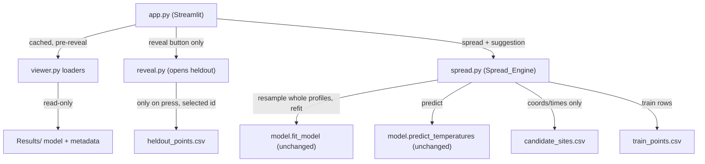

# Design Document

## Overview

Stage 6 adds an exploratory **five-model spread** and a single **suggested next measurement** on top of the Stage 5 reveal-loop viewer. One new pure module, `shelfcast/spread.py` (the Spread_Engine), holds all Stage 6 logic: it fits five reproducible ExtraTrees models by resampling **whole training candidate profiles**, computes the min-to-max spread of their predictions at a site, scores candidates by model disagreement at 5 m and 10 m, and chooses one eligible candidate to suggest. `app.py` renders the spread band alongside the existing Stage 3 prediction and the Stage 5 reveal charts, and shows the suggestion with its score and a plain-language reason.

Stage 6 changes no earlier behavior. It reuses `model.fit_model` and `model.predict_temperatures` verbatim, and it reuses the Stage 5 `reveal.py` eligibility helpers (`haversine_km`, `revealed_final_time`) and the `MIN_NEARBY_KM = 1.0` constant. `reveal.py` remains the only module that opens `heldout_points.csv`, only after the explicit reveal click, and only for the one selected profile. The spread models (pre- and post-reveal) live in memory only and never touch `Results/model.joblib`.

The spread is explicitly **an exploratory measure, not a calibrated confidence interval**; the suggestion is explicitly **a profile to test, never an optimal site or an operational boat route**. Stage 6 adds no forecasts, calibrated uncertainty, oxygen, weather, new research model, or deployment, and keeps the study region, the chronological split, the provisional-candidate-profile wording, and the unknown-bottom-depth caveat.

## Architecture



**Pre-reveal flow.** On startup `app.py` loads the training rows (full source columns) via a cached loader, builds the five spread models with `spread.fit_spread_models(train_df)`, and caches them keyed on the training file. For the selected site it computes the spread band with `spread.spread_table(models, site, DEFAULT_DEPTH_GRID)` and draws it under the existing Stage 3 curve. It then builds the pre-reveal suggestion with `spread.suggest_candidate(models, sites_df, selected_id, selected_site, after_time=selected_site_start)`.

**Post-reveal flow.** When a reveal is active for the selected profile (Stage 5 already stores `revealed_df` and the temporary single model), `app.py` fits five **updated** spread models with `spread.fit_spread_models(train_df, revealed_df)` — training rows plus only the one revealed profile's rows, with that profile forced into every resample — recomputes the spread band for the selected site, and recomputes the suggestion using the revealed profile's final measurement time as the eligibility cutoff. Updated spread models are stored in session state keyed to the selected `profile_id`, right beside the Stage 5 reveal state, so the existing `reveal.reset_reveal_state` guard clears them on a selection change or a Reset replay press.

**Boundary.** `spread.py` only ever receives in-memory frames (`train_df`, optional `revealed_df`) and the candidate-site coordinate/time table; it opens no files except through the explicit `train_points.csv`/`candidate_sites.csv` loaders it is handed, and it never opens `heldout_points.csv`. The only path to hidden data remains `reveal.read_revealed_profile`, unchanged.

## Components and Interfaces

### `shelfcast/config.py` (additive)

```python
# Stage 6 spread constants (additive; Stage 1-5 sections unchanged).
# Exactly five reproducible spread models, fixed per-model seeds so the five
# models and their predictions are reproducible run to run.
SPREAD_N_MODELS = 5
SPREAD_SEEDS = [101, 202, 303, 404, 505]
# Disagreement is scored at these shallow requested prediction levels only.
SPREAD_SCORE_DEPTHS = [5.0, 10.0]
```

### `shelfcast/spread.py` (new — the Spread_Engine)

Pure, importable, Streamlit-free. Reuses `model.fit_model`/`model.predict_temperatures` verbatim and the Stage 5 `reveal.haversine_km`/`reveal.revealed_final_time`/`reveal.MIN_NEARBY_KM`.

```python
def resample_profiles(train_df, seed):
    """Return a frame built by sampling whole candidate profile ids WITH
    replacement (profile-level bootstrap), including every reading of each
    sampled profile. Never samples individual readings and never returns a
    partial profile. Deterministic for a given (train_df, seed) via a seeded
    numpy Generator. Requires >= 2 distinct profile ids (else ValueError)."""

def fit_spread_models(train_df, revealed_df=None, seeds=SPREAD_SEEDS):
    """Fit exactly len(seeds) (five) models. For each seed, build a
    profile-level resample of train_df (plus, when revealed_df is given, the one
    selected revealed profile's rows forced into every resample so every updated
    model includes it) and call model.fit_model unchanged on the combined,
    source-column frame. Returns a list of fitted estimators held in memory only;
    never writes to disk. Raises ValueError if train_df has < 2 profile ids."""

def spread_table(models, site, depths=DEFAULT_DEPTH_GRID):
    """Per-depth min/max/mean predicted temperature across the models for the
    site's recorded coords and UTC start time, via predict_temperatures only.
    Returns a DataFrame [depth_m, temp_min, temp_max, temp_mean]. Predictions
    only; reads no heldout value."""

def disagreement_score(models, lat, lon, start_time,
                       depths=SPREAD_SCORE_DEPTHS):
    """Non-negative score = sum over the 5 m and 10 m levels of (max - min)
    predicted temperature across the models at that level, for the given coords
    and UTC start time. Higher => more disagreement. Predictions only;
    reproducible for fixed models and coords/time."""

def eligible_candidates(sites_df, selected_id, selected_site, after_time):
    """profile_ids from sites_df that exclude the selected id, lie >=
    MIN_NEARBY_KM (1 km) from the selected site (haversine_km), and have
    start_time strictly after after_time. Reads only candidate-site columns;
    never heldout."""

def suggest_candidate(models, sites_df, selected_id, selected_site, after_time):
    """Among eligible_candidates, return the highest-disagreement candidate as
    {profile_id, score, latitude, longitude, start_time}, ties broken by lowest
    profile_id. Returns None when none are eligible. Predictions only; reads no
    heldout value for any candidate."""
```

`after_time` is the selected site's recorded `start_time` before a reveal, and the revealed profile's final recorded measurement time (`reveal.revealed_final_time(revealed_df)`) after a reveal — so Requirement 4.2/4.3 are a single parameter, and the caller supplies the right value.

### `app.py` (extend Stage 5)

- Add `from shelfcast import spread` and `from shelfcast.config import SPREAD_SEEDS, SPREAD_SCORE_DEPTHS`.
- A cached loader `_load_training_rows()` returning the full source columns of `train_points.csv` (distinct from the existing location-only loader), plus a cached `@st.cache_resource` builder `_spread_models()` that calls `spread.fit_spread_models(train_df)` once for the pre-reveal five models.
- Pre-reveal: under the existing Stage 3 prediction chart, add a shaded min-to-max **spread band** (Altair `mark_area` between `temp_min` and `temp_max`) with the Stage 3 line on top, captioned "spread across five models — an exploratory measure, not a calibrated confidence interval." The Stage 5 reveal charts stay exactly as they are.
- Post-reveal: when `has_reveal`, fit updated spread models from `train_df + revealed_df`, store them in `st.session_state["spread_models_updated"]` keyed to `revealed_profile_id`, and redraw the spread band and suggestion from the updated models. The existing `reveal.reset_reveal_state` guard is extended to also clear `spread_models_updated` (see Data Models) so a selection change or Reset replay drops them.
- Suggestion panel: show the suggested `profile_id`, its score (formatted), and a plain-language reason ("the five models disagree most about temperature at 5 m and 10 m there"), labeled a profile to test — never an optimal site or boat route. When `suggest_candidate` returns `None`, show "no eligible candidate is available for a suggestion."
- All Stage 5 framing (historical replay caption, requested-prediction-level labels, eMOLT attribution, provisional-candidate-profile wording, study-region restriction) is preserved unchanged.

## Data Models

### Spread models
A Python `list` of exactly five fitted `ExtraTreesRegressor` estimators, index-aligned to `SPREAD_SEEDS`. Held in memory; never serialized.

### Spread table
`pd.DataFrame` with columns `[depth_m, temp_min, temp_max, temp_mean]`, one row per requested prediction level.

### Suggestion
`dict` `{profile_id: int, score: float, latitude: float, longitude: float, start_time}` or `None`.

### Streamlit session state (additive to Stage 5)

| key | type | meaning |
| --- | --- | --- |
| `spread_models_updated` | `list \| None` | the five updated spread models, held only for `revealed_profile_id` |

The pre-reveal five models come from the cached `_spread_models()` resource (keyed on the training file) and are never stored per-profile. The Stage 5 reset guard clears `spread_models_updated` together with `revealed_profile_id`/`revealed_df`/`temp_model`, so a selection change or Reset replay returns the app to the pre-reveal spread and pre-reveal suggestion (Req 7.1-7.4). `reveal.REVEAL_STATE_KEYS` is extended with `"spread_models_updated"` so one guard clears all reveal-scoped state.

## Correctness Properties

### Property 1: Profile-level resampling keeps profiles whole
*For any* training frame with >= 2 profile ids and any seed, every profile id present in `resample_profiles(train_df, seed)` contributes exactly the full set of rows it has in `train_df` (a whole profile), and no row of an unsampled profile appears. No individual reading is sampled independently of its profile.
**Validates: Requirements 1.1, 1.2**

### Property 2: Spread models are reproducible
*For any* training frame, `fit_spread_models(train_df)` called twice yields five models whose `spread_table`/`disagreement_score` outputs are identical, because each model uses a fixed declared seed and a deterministic seeded resample.
**Validates: Requirements 1.3, 3.4**

### Property 3: Candidate eligibility respects distance and time
*For any* sites table, selected id, selected site, and `after_time`, every id from `eligible_candidates` is not the selected id, is at least `MIN_NEARBY_KM` km away, and has `start_time` strictly after `after_time`; and `suggest_candidate` returns the highest-score eligible id, breaking ties by lowest `profile_id`, or `None` when none are eligible.
**Validates: Requirements 4.1, 4.2, 4.3, 5.1, 5.4**

### Property 4: Spread and suggestion never read hidden data
*For any* pre-reveal or scoring call, no `spread.py` function opens `heldout_points.csv` or reads a hidden `temperature_c`/`depth_m` for a scored or suggested candidate; after a reveal, only the one selected profile's rows (already read by `reveal.read_revealed_profile`) enter the updated fit.
**Validates: Requirements 1.4, 3.3, 5.5, 6.4, 8.1, 8.2**

### Property 5: Stage 6 writes nothing
*For any* fit, `fit_spread_models` creates no file and leaves the bytes of `Results/model.joblib` unchanged.
**Validates: Requirements 1.6, 6.3, 8.3**

### Property 6: Updated spread includes exactly the revealed profile
*For any* reveal, every one of the five updated spread models is fit from the training rows plus only the one selected revealed profile's rows, and no other profile's rows enter the fit.
**Validates: Requirements 6.1, 6.4**

## Error Handling

| Condition | Handling | Requirement |
| --- | --- | --- |
| Training rows have < 2 distinct profile ids | `fit_spread_models`/`resample_profiles` raise `ValueError`; `app.py` shows a message and skips the spread/suggestion, leaving the Stage 3 prediction and Stage 5 reveal intact | 1.5 |
| No eligible candidate for a suggestion | `suggest_candidate` returns `None`; `app.py` shows "no eligible candidate is available for a suggestion" and no profile/score/reason | 5.4 |
| Reveal/reset/selection change | The extended `reveal.reset_reveal_state` guard clears `spread_models_updated` with the other reveal keys; app returns to the pre-reveal spread and suggestion | 7.1, 7.2, 7.3 |
| Any write attempt by a spread fit | `fit_spread_models` calls only `model.fit_model`, which does not persist; no `save_model`/`joblib.dump` is called | 1.6, 8.3 |

## Testing Strategy

New focused tests live in `tests/test_spread.py`, following `test_reveal.py` conventions (the `open_spy` fixture recording every `pd.read_csv`/`open`, and `_require_model()` to skip when `Results/model.joblib` is absent). Required (non-optional) essential tests:

- **Profile-level resampling** (Property 1): a synthetic multi-profile frame; assert every resampled profile keeps all its rows and partial profiles never appear.
- **Reproducibility** (Property 2): two `fit_spread_models` runs give identical `spread_table` and `disagreement_score` outputs; a single-profile frame raises `ValueError`.
- **Candidate eligibility and tie-breaking** (Property 3): synthetic site tables exercise the >= 1 km rule, the strictly-after-`after_time` rule, the exclusion of the selected site, highest-score selection, tie-break to lowest `profile_id`, and the `None` case.
- **Reveal/reset isolation** (Property 6 + reset): the extended `reset_reveal_state` clears `spread_models_updated`; updated fits include exactly the training rows plus the one revealed profile.
- **Hidden-data boundary** (Property 4/5): with `open_spy`, pre-reveal spread and suggestion never open `heldout_points.csv` or `profile_summary.csv`; `fit_spread_models` writes nothing and leaves `Results/model.joblib` bytes unchanged.

Optional hardening (after MVP): generative (Hypothesis) expansion of the resampling and eligibility properties.
